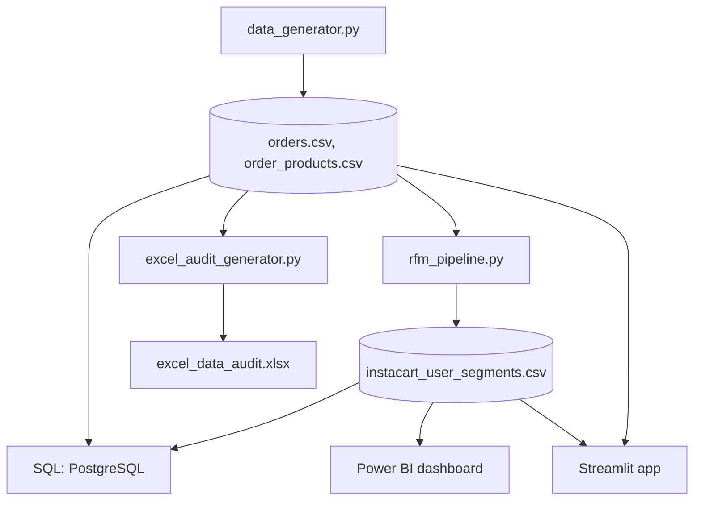

# Instacart Customer Retention & Behavioral Churn Intelligence

## Project Overview

This project delivers an end-to-end data analytics solution focused on understanding and predicting customer retention and behavioral churn for an Instacart-like grocery delivery service. Leveraging a simulated dataset, the project demonstrates a comprehensive approach from data auditing and RFM (Recency, Frequency, Monetary) segmentation to SQL warehousing and Power BI dashboard specifications. The goal is to provide actionable insights for strategic decision-making to improve customer lifetime value.

### Architecture Diagram



**Explanation of Flow:**
1.  **`data_generator.py`** creates synthetic orders (with real order dates) and order items.
2.  **`rfm_pipeline.py`** computes Recency, Frequency and Monetary scores per user and assigns one of four segments.
3.  **`excel_audit_generator.py`** builds a data-quality workbook from the raw orders.
4.  **SQL** defines the schema and analytical queries (segment breakdown, expanding-interval churn signal, peak hours).
5.  **Power BI** specification and **Streamlit app** (`app.py`) present the results interactively.

> **Note:** the data is **synthetic**. Users are generated from four behaviour patterns (loyal, at-risk, churned, occasional), so findings illustrate the method, not real Instacart customers.

## Data & Metric Definitions

-   **Recency (`recency_days`)**: days from a user's last order to the snapshot date (latest order date + 1 day).
-   **Frequency**: number of orders. **Monetary**: total items bought (the dataset has no prices).
-   **Scores**: each metric is split into quartiles (1-4, 4 = best; for recency, fewer days = higher score).
-   **Segments**: Loyal Power Users (R>=3, F>=3), At Risk (High Volume) (R<=2, F>=3), Churned / Dormant (R<=2, F<=2), Occasional Shoppers (R>=3, F<=2).
-   **`avg_lapse`**: average days between a user's orders; empty for users with a single order.
-   **`order_dow`**: 0 = Monday ... 6 = Sunday.

## Business Problem Statement

Customer churn is a critical challenge for subscription-based and repeat-purchase businesses like Instacart. The objective of this project is to quantify customer churn and order drop-offs by developing a robust analytical framework. This framework aims to:

-   **Identify at-risk customers**: Pinpoint users exhibiting behaviors indicative of potential churn.
-   **Segment customer base**: Categorize users based on their purchasing patterns to tailor marketing and retention strategies.
-   **Understand behavioral trends**: Analyze ordering frequency, recency, and monetary value to uncover key drivers of retention and churn.
-   **Provide actionable insights**: Deliver data-driven recommendations to reduce churn and enhance customer loyalty.

## Key Findings & Business Recommendations

*(TODO: replace these example findings with the real numbers from your final run.)*

**Potential Key Findings:**

-   **Churned/Dormant Segment Size**: A significant portion of users fall into the 'Churned / Dormant' category, indicating a need for re-engagement strategies.
-   **Expanding Order Intervals**: A subset of 'At Risk' users show a consistent increase in `days_since_prior_order`, suggesting a gradual disengagement.
-   **Peak Ordering Behavior**: Different customer segments exhibit distinct peak ordering hours and days, which can inform targeted promotional timing.

**Business Recommendations:**

1.  **Targeted Re-engagement Campaigns**: Implement personalized email or in-app campaigns for 'Churned / Dormant' users, offering incentives or highlighting new features.
2.  **Proactive Intervention for At-Risk Users**: For users with expanding order intervals, trigger automated notifications or special offers to encourage earlier next purchases.
3.  **Optimize Marketing Spend**: Align promotional activities and delivery slot availability with the peak ordering hours and days of 'Loyal Power Users' and 'Occasional Shoppers' to maximize impact.
4.  **Personalized Product Recommendations**: Leverage insights from 'total_items_bought' and 'frequency' to offer highly relevant product suggestions, especially for 'Occasional Shoppers' to increase their engagement.

## How to Run the Project

### 1. Project Structure

```
instacart-retention-analytics/
├── data/               orders.csv, order_products.csv, instacart_user_segments.csv
├── excel/              excel_data_audit.xlsx
├── python/             data_generator.py, rfm_pipeline.py, excel_audit_generator.py
├── sql/                schema_and_queries.sql
├── powerbi/            dashboard_spec.md
├── app.py              Streamlit dashboard
├── requirements.txt
└── README.md
```

### 2. Python Scripts

```bash
pip install -r requirements.txt
python python/data_generator.py          # 1. generate orders + order items
python python/rfm_pipeline.py            # 2. RFM scores + segments
python python/excel_audit_generator.py   # 3. Excel data audit
streamlit run app.py                     # 4. interactive dashboard
```

Run the commands from the project root. The scripts use paths relative to their own location, so they also work from other folders. Run steps 1-2 in order; step 3 only needs step 1.

### 3. SQL Queries

The `schema_and_queries.sql` file contains `CREATE TABLE` statements, `COPY` commands (for PostgreSQL), and analytical queries.

**a. Database setup:** create a PostgreSQL database and open `psql` in the project root folder.

**b. Create tables and load data:** run the `CREATE TABLE` statements in `schema_and_queries.sql`, then the three `\copy` lines shown in the loading section (they use relative paths, so no editing is needed).

**c. Run the analytical queries:** segment breakdown, rolling interval lag (per order and per user), and peak ordering hour per segment and day. The script is written for PostgreSQL.

### 4. Power BI Dashboard Specification

The `dashboard_spec.md` file in the `powerbi/` directory provides a detailed guide for building the Power BI dashboard. It includes:

-   **Data Model Diagram description**: Explains the relationships between `user_segments` and `orders` tables.
-   **Explicit DAX Measures**: Defines the DAX formulas for key metrics.
-   **Layout & Visual Map**: Describes the recommended layout and types of visualizations to include.

Follow these specifications to create an interactive and insightful Power BI dashboard. You will need to import the `orders.csv` and `instacart_user_segments.csv` files into Power BI and establish the described relationships and measures. 

---

**Author**: Ritish Kumar Yadav
**Date**: October 2026
